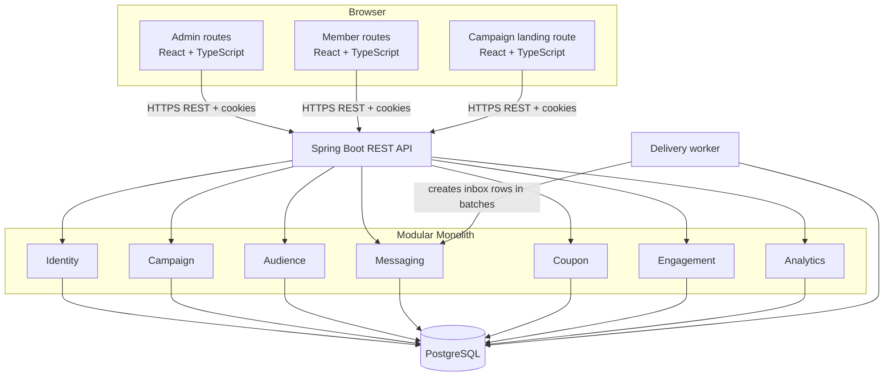

# System Architecture

**Status:** Approved — part of the owner-approved v1.5.0 Development Baseline  
**Applies to:** MVP described in `docs/PRD.md`  
**Implementation:** Phase 1 repository foundation in progress; business capabilities are not yet implemented

## 1. Goals

- Deliver the complete campaign-to-coupon-claim journey with a small operational footprint.
- Keep business rules independent of Spring, persistence, and UI frameworks.
- Provide explicit boundaries between Admin and Member capabilities.
- Protect coupon inventory and claim uniqueness under concurrent requests.
- Make message delivery and event ingestion retryable and idempotent.
- Leave extension seams for future channels without implementing a generic plugin framework.

## 2. Architecture decisions

| Concern | MVP decision | Rationale |
|---|---|---|
| Architecture style | Modular monolith using Clean Architecture principles | One deployable backend, clear module boundaries, low operational complexity |
| Backend | Java 21 + Spring Boot | Fits the Java backend project and supports Spring Security, validation, transactions, and observability |
| Frontend | One React + TypeScript SPA | Two route-level experiences without maintaining two separate frontend builds |
| Database | PostgreSQL | Transactions, unique constraints, conditional updates, JSONB rules, and relational reporting |
| Authentication | Spring Security + JWT access/refresh tokens in HttpOnly cookies | Browser-oriented authentication with refresh/revocation support |
| Message delivery | Database-backed asynchronous worker/outbox pattern | Retryable delivery without requiring Kafka for the MVP |
| Event ingestion | REST endpoint + PostgreSQL persistence | Sufficient for MVP volume; idempotency enforced in DB |
| Deployment | Backend and frontend built separately; PostgreSQL service | Simple local and demo deployment |

## 3. High-level component view



The diagram is logical, not a deployment topology. Modules share one application process and one PostgreSQL database, but must not bypass one another's public application interfaces to manipulate another module's tables.

## 4. Runtime flows

### 4.1 Campaign publication and immediate message delivery

1. Admin calls the publish endpoint.
2. Application validates the draft campaign, its date range, `starts_at <= now < ends_at`, exactly one configured message, at least one coupon with positive inventory, and audience definition. Future-dated scheduled publication is rejected.
3. In one publication transaction, the application resolves the effective audience with a set-based query, inserts the complete member snapshot, changes campaign status, and writes one delivery job/outbox record. The MVP assumes this single snapshot transaction is practical for the initial/demo audience size.
4. One delivery worker processes the committed job in bounded batches; Pause does not cancel it, even if it remains `PENDING` until the worker picks it up. Multi-worker leases and `FOR UPDATE SKIP LOCKED` are deferred.
5. For each snapshot member, it creates a member inbox record using a unique campaign/member key. Re-running a batch is safe.
6. Inbox inserts and the last processed member cursor are committed in the same batch transaction. Batches contain 100 snapshot members. On batch failure the transaction rolls back and the cursor remains unchanged. The initial attempt plus three automatic retries are allowed; retry delays are 1s, 2s, and 4s. `attempt_count` counts automatic retries already consumed (0–3); a fourth total failure at the same cursor makes the job `FAILED`. Successful batches reset the counter. Admin may manually retry only `FAILED`, preserving cursor and resetting attempt count. On restart, interrupted `PROCESSING` is reset to `PENDING`. An empty snapshot has a `COMPLETED` job at publication.

The publish HTTP request must not synchronously create every inbox record. “Immediate” means the delivery job is committed with publication and the single worker begins processing promptly; actual inbox materialization completes asynchronously. Snapshot resolution itself remains part of the publication transaction in this simplified MVP. A separate snapshot job/state machine is a future scale-driven option, not part of the current design.

### 4.2 Coupon claim

1. Member submits a claim request with an authenticated session and an idempotency key.
2. Application first checks for an existing successful result by `(member_id, idempotency_key)` and returns it (or an idempotency conflict) before evaluating current eligibility. If no result exists, the claim transaction locks the campaign row with `SELECT ... FOR SHARE`, re-checks the idempotency key to cover concurrent requests, then checks campaign status/window, audience snapshot membership, and coupon window.
3. The transaction conditionally increments claimed quantity only if inventory remains, then inserts the claim record. The campaign row lock is held through commit and is acquired before the coupon inventory row lock.
4. The unique claim constraint prevents a duplicate member/coupon claim.
5. Any failure to insert the claim rolls back the inventory update.
6. The response is derived from the committed claim record. Analytics events are not the source of truth for ownership.

### 4.3 Engagement event

1. Client generates a UUID event ID and submits an impression, click, or landing-page-view event.
2. Backend derives member identity from authentication and validates the campaign/message relationship. Impression/click is accepted only if the member has the corresponding `member_messages` inbox row; landing-page views may be recorded for any authenticated visitor.
3. Database unique key `(member_id, event_id)` deduplicates client event retries. Claim-attempt audit events are server-generated per authenticated claim request; successful audit is in the claim transaction and failed audit is written after rollback in a separate short transaction.
4. Analytics reads persisted events and business claim records.

## 5. Backend layering

- **Presentation:** REST controllers, request/response DTOs, validation, cookie/CSRF handling.
- **Application:** use cases, orchestration, transaction boundaries, ports, authorization checks.
- **Domain:** campaign lifecycle, audience semantics, coupon eligibility, inventory/claim invariants.
- **Infrastructure:** JPA/JDBC repositories, PostgreSQL adapters, JWT implementation, delivery worker, clock, logging.

Dependencies point inward. Domain code must not import Spring MVC, Spring Data, Hibernate, JDBC, or provider SDKs.

## 6. Frontend structure

One SPA in `frontend/`:

- `/admin/**`: campaign CRUD, audience segments, coupon configuration, campaign analytics.
- `/member/**`: login, inbox, claimed coupons, member profile.
- `/campaigns/:campaignId`: public campaign landing page within the same SPA; claim actions require member authentication.

Pausing a campaign prevents new coupon claims after the pause transaction commits. Claim transactions acquire a shared lock on the campaign row before checking status and hold it through commit; Pause updates the same row and waits for claims that acquired the lock first. Claims beginning after Pause commits are rejected. A delivery job committed during publication continues to completion even if it is still `PENDING` when Pause commits; existing inbox messages are not retracted. Published landing pages remain public while paused or ended, but coupon claims are disabled. An authenticated member outside the snapshot is shown an explicit not-eligible state.

The frontend must not contain business authorization logic as a security boundary. The backend remains authoritative for roles, audience membership, campaign state, coupon eligibility, and inventory.

Suggested frontend boundaries:

```text
frontend/src/
  app/                 # router, providers, app bootstrap
  features/
    auth/
    admin/campaigns/
    admin/audiences/
    admin/analytics/
    member/messages/
    member/coupons/
    campaigns/landing-page/
  shared/
    components/
    hooks/
    lib/
  api/                 # typed API client and generated OpenAPI types
```

## 7. MVP exclusions

Do not add Redis, Kafka, microservices, distributed locks, scheduled-delivery infrastructure, external email/push/SMS providers, event streaming platforms, or a generic plugin system unless an approved requirement change demonstrates the need.

## 8. Operational baseline

- One Spring Boot backend instance is sufficient for the initial demo; design must remain stateless at the web tier except for persisted refresh-token state.
- PostgreSQL is the source of truth. Composite foreign keys enforce campaign/message/coupon ownership for inbox and engagement rows.
- The MVP runs one database-backed delivery worker and uses bounded batches plus a persisted cursor. If multiple worker instances are introduced later, add safe row claiming/leases (for example, `FOR UPDATE SKIP LOCKED`) through a reviewed design change.
- Provide health endpoints, structured logs, request correlation IDs, and metrics for publication, delivery backlog/failures, event ingestion, and coupon claims.
- Time storage: persist timestamps as `timestamptz` in UTC; present campaign times in `Asia/Taipei` unless product owner changes this decision.

## 9. Open implementation details

These are intentionally deferred to implementation planning and must be decided before the affected code is written: exact Spring Boot minor version, build tool and dependency versions, ORM vs JDBC choices per use case, deployment hosting, frontend UI library, and production secrets management. Do not silently add infrastructure dependencies.
