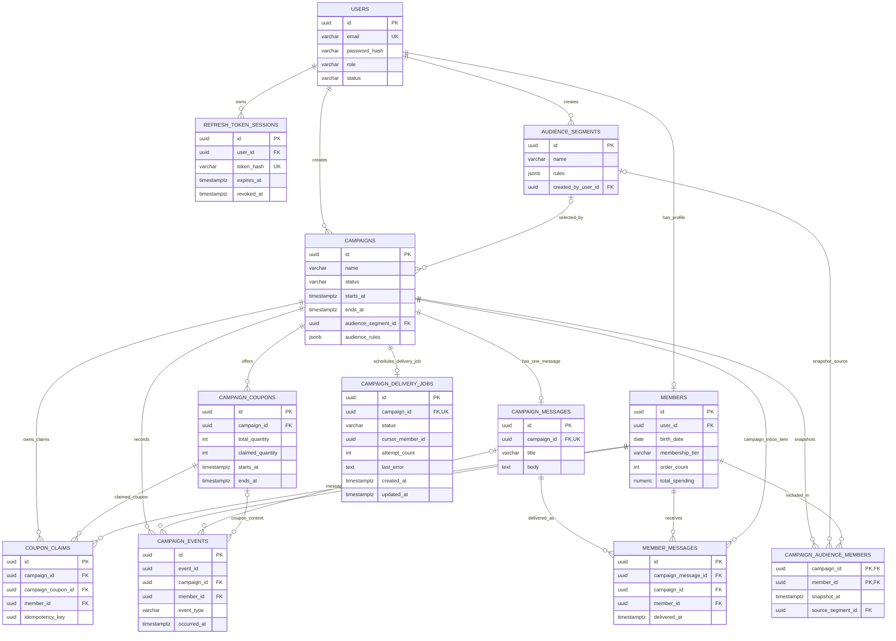

# Entity Relationship Diagram

**Status:** Proposed — logical ERD, not a physical migration specification.

## Cardinality and integrity notes

- `users` is the shared identity table for both administrators and members; `users.role` distinguishes `ADMIN` and `MEMBER`. Only member users have a one-to-one `members` profile containing member-specific attributes.
- `campaign_coupons` is campaign-owned through `campaign_id`. The MVP has no separate global coupon master or reusable promotion-rule entity; supported discount metadata is `FIXED_AMOUNT` or `PERCENTAGE`. `PERCENTAGE` stores percentage points (for example, `10` means 10% off); monetary amounts are TWD.

- `campaign_messages.campaign_id` is unique: exactly one message per campaign in the MVP.
- `campaign_delivery_jobs.campaign_id` is unique: one delivery job per campaign; retries update the same job.
- `campaign_audience_members` has composite primary key `(campaign_id, member_id)`.
- `member_messages` has unique `(campaign_id, member_id)`.
- `coupon_claims` has unique `(campaign_id, campaign_coupon_id, member_id)`.
- `campaign_events` has unique `(member_id, event_id)`.
- Campaign coupon ownership and campaign IDs must agree; `coupon_claims(campaign_id, campaign_coupon_id)` references the unique `(campaign_id, id)` pair on `campaign_coupons`.
- `campaign_delivery_jobs` is one row per campaign. The MVP uses one worker; the cursor and attempt/error fields support batch resume without a lease/lock table.
