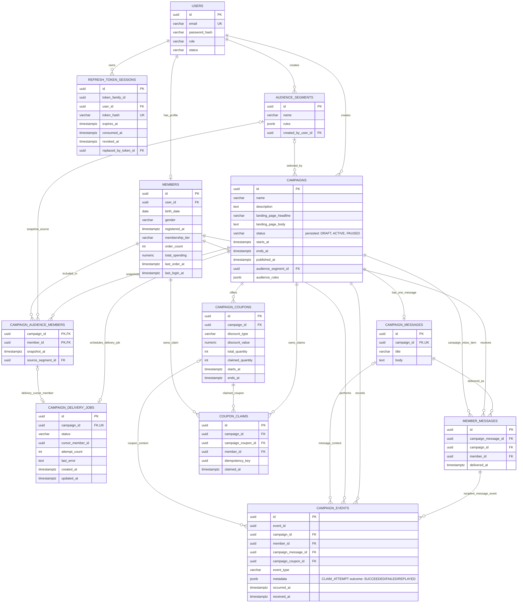

# Entity Relationship Diagram

**Status:** Approved — part of the owner-approved v1.5.0 Development Baseline; logical ERD, not a physical migration
specification.

## Cardinality and integrity notes

- `users` is the shared identity table for both administrators and members; `users.role` distinguishes `ADMIN` and
  `MEMBER`. Only member users have a one-to-one `members` profile containing member-specific attributes.
- `campaign_coupons` is campaign-owned through `campaign_id`. The MVP has no separate global coupon master or reusable
  promotion-rule entity; supported discount metadata is `FIXED_AMOUNT` or `PERCENTAGE`. `PERCENTAGE` stores percentage
  points (for example, `10` means 10% off); monetary amounts are TWD.

- `campaign_coupons.total_quantity` must be at least 1; zero-inventory coupons are invalid configuration.
- `campaign_messages.campaign_id` is unique: exactly one message per campaign in the MVP.
- `campaign_delivery_jobs.campaign_id` is unique: one delivery job per campaign; retries update the same job.
- A campaign must define at least one audience source (`audience_segment_id` or `audience_rules`); when both are
  present, the evaluator combines them with AND.
- `campaign_audience_members` has composite primary key `(campaign_id, member_id)`.
- `member_messages` has unique `(campaign_id, member_id)` and `(campaign_id, campaign_message_id, member_id)`, plus
  composite FK `(campaign_id, campaign_message_id)` → `campaign_messages(campaign_id, id)`.
- `coupon_claims` has unique `(campaign_id, campaign_coupon_id, member_id)`.
- `campaign_events` has unique `(member_id, event_id)` and composite FKs for optional
  `(campaign_id, campaign_message_id)`, `(campaign_id, campaign_coupon_id)`, and
  `(campaign_id, campaign_message_id, member_id)` recipient-message context. `IMPRESSION`/`CLICK` require a message
  context; `CLAIM_ATTEMPT` has no message context and may have a nullable coupon context when the requested coupon ID is
  invalid/mismatched; `LANDING_PAGE_VIEW` has neither.
- `campaign_messages` exposes `UNIQUE (campaign_id, id)` so `member_messages` and `campaign_events` cannot reference a
  message owned by another campaign.
- Each `refresh_token_sessions` row is one token generation; `token_family_id` groups rotations for one login session. A
  composite self-FK ensures `replaced_by_token_id` belongs to the same user and token family. Reuse of a consumed token
  revokes the family.
- `campaign_delivery_jobs.attempt_count` counts automatic retries already consumed at the current cursor (0–3); the
  initial attempt plus three automatic retries are allowed, and a fourth total failure moves the job to `FAILED`. Manual
  retry preserves the cursor.
- `campaign_events.CLAIM_ATTEMPT` is server-generated; `metadata.outcome` is `SUCCEEDED`, `FAILED`, or `REPLAYED`.
- Campaign coupon ownership and campaign IDs must agree; `coupon_claims(campaign_id, campaign_coupon_id)` references the
  unique `(campaign_id, id)` pair on `campaign_coupons`. `member_messages` and `campaign_events` use matching composite
  FKs for campaign/message/coupon context.
- `campaign_delivery_jobs.cursor_member_id`, when set, references a member in the same campaign audience snapshot
  through composite FK `(campaign_id, cursor_member_id)`.
- `campaign_delivery_jobs` is one row per campaign. The MVP uses one worker and batches of 100; the initial attempt plus
  three automatic retries (1s/2s/4s backoff) are allowed; a fourth total failure marks it `FAILED`. Admin retry resets
  the retry count and resumes from the cursor. A zero-member snapshot creates a `COMPLETED` job. Pause does not cancel a
  committed job, including a job still waiting in `PENDING`.
- Persisted campaign states are `DRAFT`, `ACTIVE`, and `PAUSED`. `ENDED` is derived when
  `published_at IS NOT NULL AND ends_at <= now()`, whether the persisted state was `ACTIVE` or `PAUSED`; no
  status-transition worker is required.
